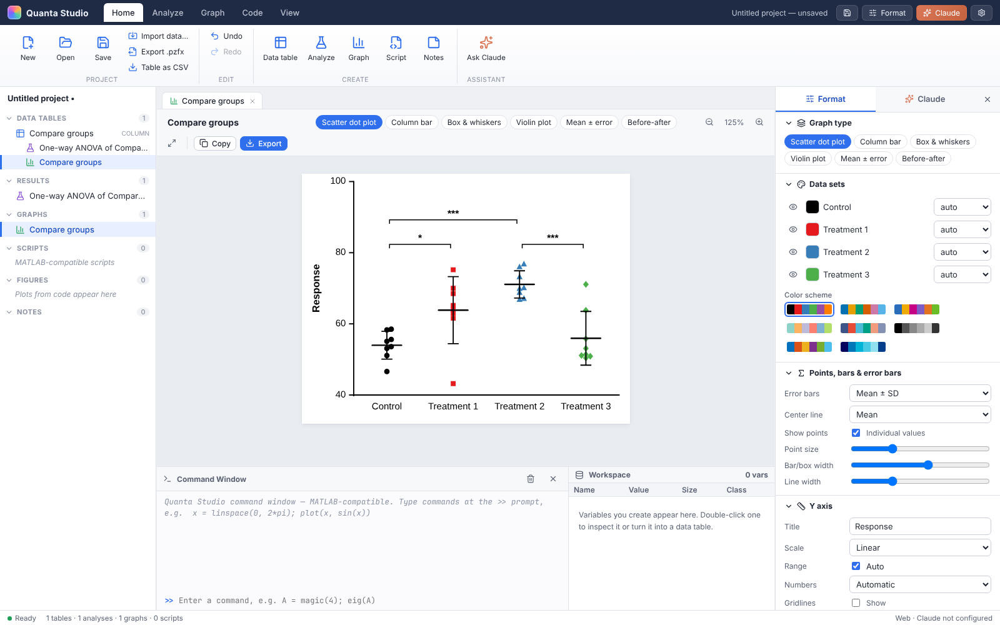
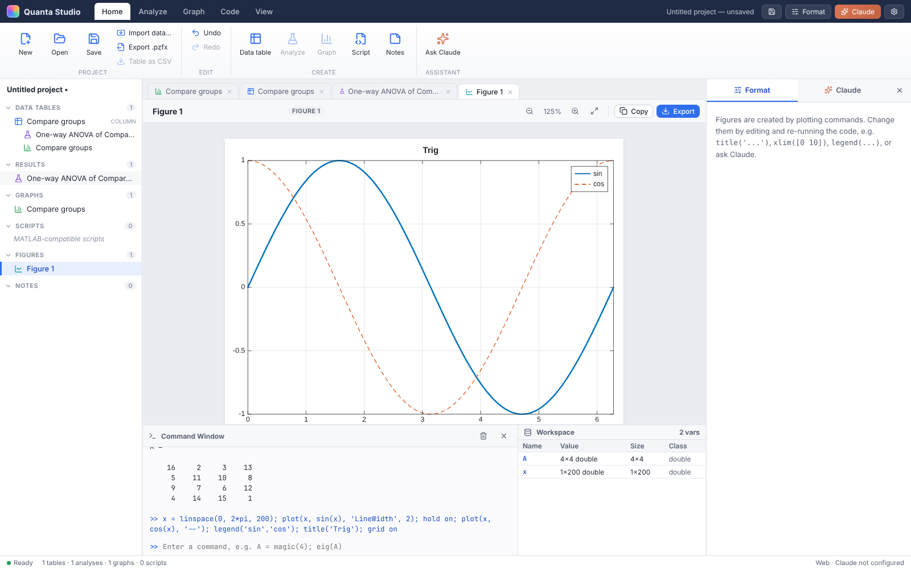
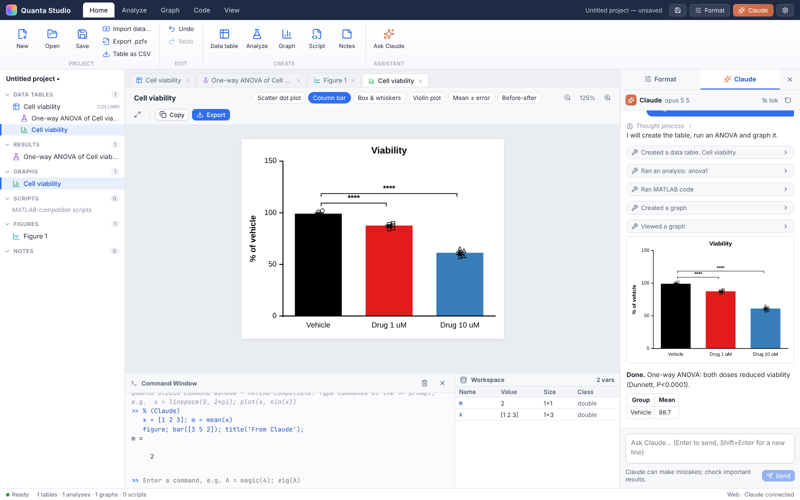

# Quanta Studio

**Scientific graphing, biostatistics and numerical computing in one desktop app, with Claude built in.**

Quanta Studio combines a Prism-style workflow (structured data tables → linked analyses → publication-quality graphs) with a MATLAB-compatible numerical computing environment (scripts, command window, workspace, figures). Claude is integrated as a research assistant that can set up tables, choose and run analyses, build and check graphs, and write and run code in your project. External Claude apps (Claude Desktop, Claude Code) can connect too, over MCP.



## Download

Installers for **Windows** (`.exe` installer and portable), **macOS** (`.dmg`, Intel and Apple Silicon) and **Linux** (`.AppImage`, `.deb`) are built automatically by GitHub Actions:

- **Releases:** tagged versions (`v*`) are published on the repository's *Releases* page.
- **Latest build:** open the *Actions* tab → *Build desktop apps* → the latest run → *Artifacts*.

The builds are not code-signed yet. On Windows choose *More info → Run anyway* in SmartScreen. On macOS right-click the app → *Open* the first time. On Linux run `chmod +x Quanta*.AppImage` and start it.

## Features

### Data tables
Seven table types, each with a spreadsheet editor (keyboard navigation, multi-cell selection, paste from Excel/Sheets, exclude values, insert/delete rows, rename data sets):

| Table | Use it for |
|---|---|
| **XY** | Dose-response, time courses, standard curves, regression. Replicates or mean/SD/N, mean/SEM/N. |
| **Column** | Comparing groups (t tests, ANOVA, nonparametric tests). |
| **Grouped** | Two grouping factors with replicates (two-way ANOVA, grouped bars). |
| **Contingency** | Counts (chi-square, Fisher's exact, RR/OR). |
| **Survival** | Time-to-event with censoring (Kaplan-Meier). |
| **Parts of whole** | Fractions of a total (pie/donut). |
| **Multiple variables** | Correlation matrices, multiple regression, PCA. |

### Analyses (linked: they recalculate when data change)
- **Column statistics:** descriptive statistics (mean, SD, SEM, CI, quartiles, CV, geometric/harmonic means, skewness, kurtosis), normality and lognormality (Shapiro-Wilk, D'Agostino-Pearson, Kolmogorov-Smirnov), one-sample t / Wilcoxon, Grubbs outliers, frequency distributions, ROC curves, Bland-Altman.
- **Comparisons:** unpaired, Welch and paired t tests; Mann-Whitney; Kolmogorov-Smirnov; Wilcoxon matched pairs. One-way ANOVA (ordinary, Welch, Brown-Forsythe, repeated measures with Geisser-Greenhouse correction), Kruskal-Wallis, Friedman. Multiple comparisons: Tukey, Dunnett, Šídák, Holm-Šídák, Bonferroni, Fisher's LSD, Games-Howell, Dunn's.
- **Two-way ANOVA** (Type III sums of squares) with simple-effect and main-effect comparisons; multiple t tests with Holm-Šídák/FDR.
- **Regression:** linear regression (slope comparison, runs test, confidence/prediction bands). Nonlinear curve fitting with 20+ built-in models (4PL/3PL dose-response, Michaelis-Menten, binding, one/two-phase exponential, growth, Gaussian, Boltzmann, polynomials and more) or your own equation, with constraints, weighting, an extra-sum-of-squares model comparison and interpolation of unknowns.
- **Correlation** (Pearson, Spearman), correlation matrices, multiple linear regression (with VIF), PCA, area under the curve.
- **Survival:** Kaplan-Meier with log-log confidence intervals, median survival, log-rank (Mantel-Cox) and Gehan-Breslow-Wilcoxon tests, log-rank trend test, hazard ratios.
- **Contingency:** chi-square (with Yates correction), Fisher's exact, chi-square for trend, relative risk, odds ratio, NNT, sensitivity/specificity.
- **Data processing:** transforms, normalization, row statistics.

The statistics engine is checked against SciPy and statsmodels reference values in the test suite (t, F and χ² distributions, studentized range, Dunnett, Shapiro-Wilk, Type III ANOVA, 4PL fits, log-rank, Fisher, …).

### Graphs
Scatter dot plots, column bars, box & whiskers, violin plots, mean ± error, before-after, XY with fitted curves and confidence bands, grouped/stacked bars, grouped scatter, Kaplan-Meier survival curves with censor marks, pie/donut, histograms and heat maps. There are publication defaults (open L-shaped axes, outward ticks, Arial), multiple color schemes, log axes, SD/SEM/95% CI/range error bars, and automatic **significance brackets** (`*` `**` `***` `****`) from any t test or ANOVA.

**Export:** PDF and SVG (vector), TIFF (300–1200 dpi, PackBits-compressed), PNG and JPEG, plus copying to the clipboard.

### MATLAB-compatible computing


A large subset of the MATLAB language runs in a background engine, so the interface stays responsive and long runs can be stopped:

- **Language:** matrices, `end`, colon ranges, logical indexing, growth and deletion, implicit expansion, complex numbers, integer classes, strings, cell arrays, structs and struct arrays, cs-lists (`c{:}`), anonymous functions and closures, local functions, `varargin`/`varargout`, `nargin`/`nargout`, `if`/`for`/`while`/`switch`/`try`, `global`/`persistent`, command syntax (`hold on`, `format long`), `eval`, MATLAB-style display and error messages.
- **Math & linear algebra:** elementwise functions, reductions, sorting, set operations, `inv`, `det`, `\`, `eig`, `svd`, `qr`, `lu`, `chol`, `pinv`, `null`, `expm`, `kron`, norms, condition numbers.
- **Numerics:** `polyfit`/`polyval`/`roots`/`conv`, `interp1` (linear, spline, pchip), `integral` (including infinite limits), `trapz`, `fzero`, `fminsearch`, `fminbnd`, `fsolve`, `lsqcurvefit`, `ode45`/`ode23`, `fft`/`ifft`, `filter`.
- **Statistics functions:** distribution functions (`normcdf`, `tinv`, `chi2cdf`, …), random numbers, `ttest`, `ttest2`, `anova1`, `ranksum`, `signrank`, `corr`, `regress`, `fitlm`.
- **Plotting:** `figure`, `subplot`, `hold`, `plot` (line specs and name/value pairs), `scatter`, `bar`, `histogram`, `errorbar`, `area`, `stairs`, `stem`, `pie`, `boxplot`, `imagesc`, `contour`, `surf`/`mesh`, `plot3`, `fplot`, `xline`/`yline`, `text`, `legend`, `colorbar`, `colormap`, axis control, `saveas`.
- **Files:** `load`/`save` read and write real **.mat** files (Level 5, compressed), plus `readmatrix`, `writematrix` and `fileread`.
- **Bridge to the data tables:** `gettable`, `puttable`, `listtables`, `analyze(table, kind, ...)` and `prismgraph(table, chart)` move data between code and the Prism-style project.

### Claude


Open the **Claude** panel and describe what you need. Claude works through tools that operate on the open project: it can read and create data tables, run and tune analyses, create and format graphs (and *look* at them to check the result), run MATLAB code in a sandbox (no file access, 30 s limit) and write scripts. Every action appears in the chat and can be undone.

1. Get an API key at <https://console.anthropic.com>.
2. In Quanta Studio open **Settings → Claude** and paste the key. On the desktop it is stored encrypted with the OS keychain (Electron `safeStorage`) and is only sent to the Anthropic API. You can also set `ANTHROPIC_API_KEY` in the environment.
3. Pick a model (default **Claude Opus 5.5**) and an effort level.

#### Use Quanta Studio from Claude Desktop or Claude Code (MCP)
In **Settings → Claude**, enable *Allow external Claude apps*. Quanta Studio then shows the exact configuration to paste into `claude_desktop_config.json`, or a `claude mcp add …` command for Claude Code. The server runs the Quanta Studio executable in Node mode (`ELECTRON_RUN_AS_NODE=1`) as a stdio MCP server and relays tool calls, over an authenticated localhost connection, to the window you have open. The tools are the same as the in-app assistant's.

### Files and compatibility
| Format | Support |
|---|---|
| `.quanta` | Native project (tables, analyses, graphs, scripts, figures, notes) |
| `.pzfx` (Prism XML) | Import and export of data tables (all table types, replicates and mean/SD/N formats, row titles, excluded values) and info notes |
| `.csv` / `.tsv` / `.txt` | Import as any table type; export tables |
| `.m` | Open, edit, run and save MATLAB scripts and function files |
| `.mat` | Load into and save from the workspace (MAT-file v5–v7, compressed or not) |
| Graphs | PDF, SVG, TIFF, PNG, JPEG |

Graphs and analyses inside `.prism`/`.pzfx` files are stored in an undocumented binary section, so only the data tables and notes are exchanged. MATLAB `.fig` files and v7.3 (HDF5) `.mat` files are not supported.

## Building from source

Requirements: Node.js 20+ (22 recommended).

```bash
npm install
```

```bash
npm run dev          # desktop app with hot reload (Vite + Electron)
```

```bash
npm run dev:web      # run the UI in a browser at http://localhost:5173
```

```bash
npm test             # statistics, interpreter, file-format and rendering tests (vitest)
```

```bash
npm run dist         # build installers for the current OS into ./release
```

To publish installers for all platforms, push a version tag. The *Build desktop apps* workflow builds them and attaches them to a GitHub Release:

```bash
git tag v1.0.0 && git push origin v1.0.0
```

### Project layout
```
electron/        Electron main process (app:// protocol, menus, file dialogs, PDF export,
                 encrypted API key, Claude streaming, MCP relay) and preload bridge
src/stats/       Statistics engine (distributions, tests, ANOVA, regression, survival, …)
src/analysis/    Analysis registry: tables → results sheets, derived tables, fit curves
src/lang/        MATLAB-compatible language: lexer, parser, interpreter, builtins, worker
src/graph/       Figure spec, Prism-style graph compiler, SVG renderer, exporters
src/io/          .pzfx, .csv, .mat, .quanta formats
src/claude/      Claude agent loop, tool definitions, MCP bridge
src/ui/          React interface (navigator, data grid, results, graph inspector, editor, …)
tests/           vitest suites (+ SciPy reference fixture and generator script)
```

## Limitations
- Arrays are two-dimensional (no N-D arrays), and there is no Simulink, symbolic math or toolbox-specific objects (`table`, `datetime`, `containers.Map` are approximated or absent).
- Some MATLAB output formats differ cosmetically from MATLAB.
- Two-way repeated-measures ANOVA, mixed models, nested tables and Cox regression are not implemented yet.
- PDF export needs the desktop app; the browser build offers SVG instead.

## Trademarks
GraphPad Prism is a trademark of GraphPad Software/Dotmatics, and MATLAB is a trademark of The MathWorks, Inc. Quanta Studio is an independent project, not affiliated with or endorsed by either company. It is an original implementation based on publicly documented file formats and standard statistical and numerical methods.

## License
MIT
